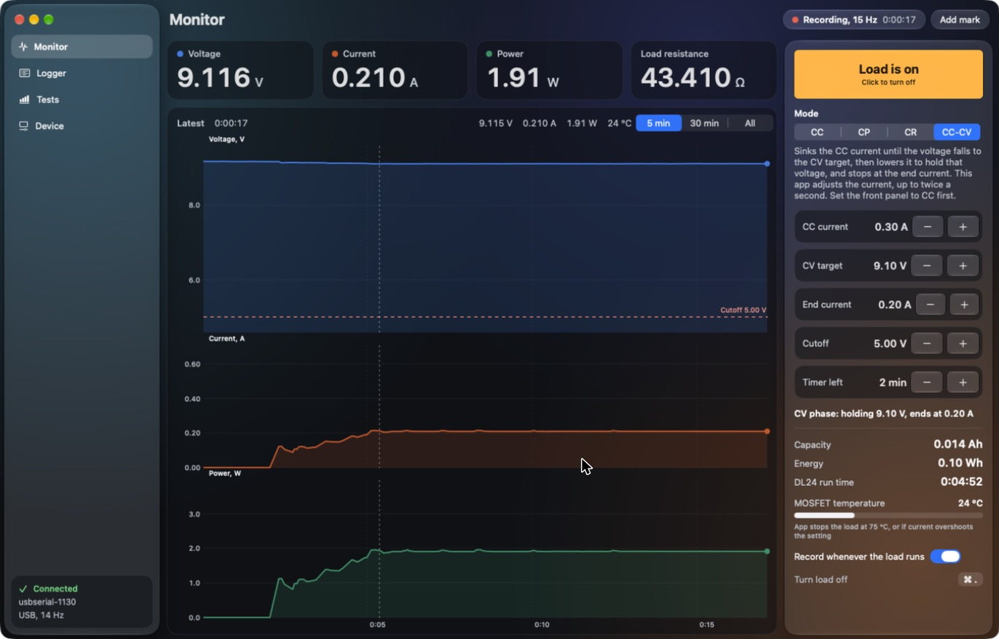
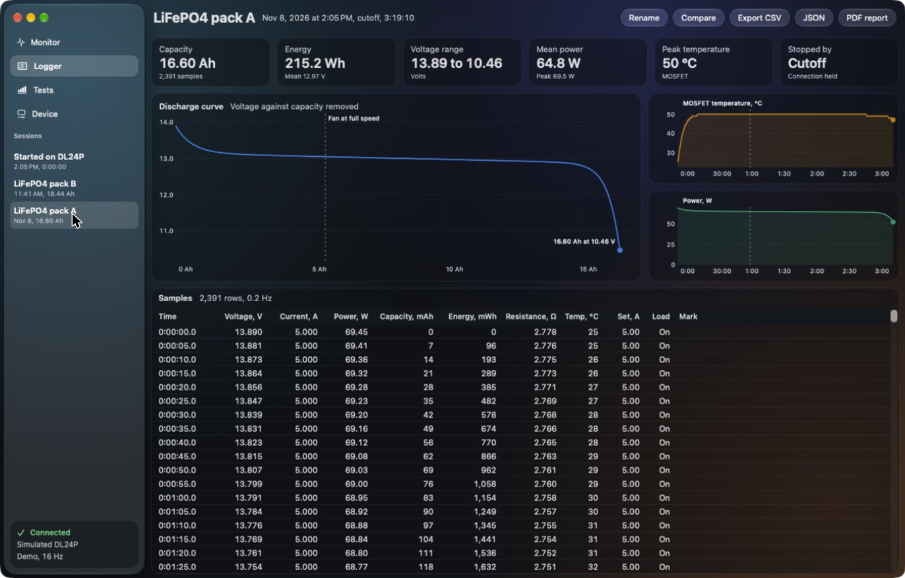
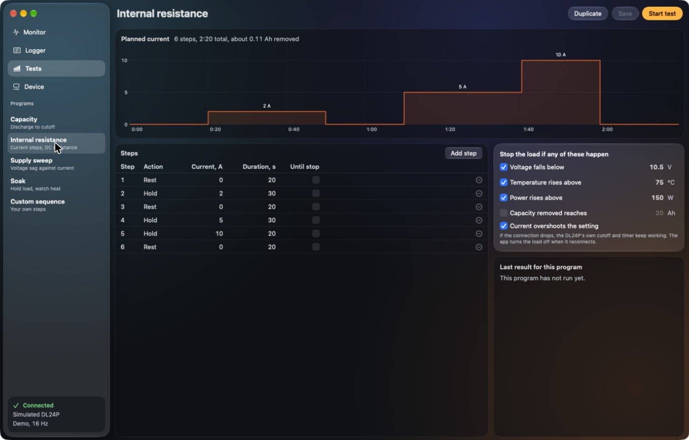
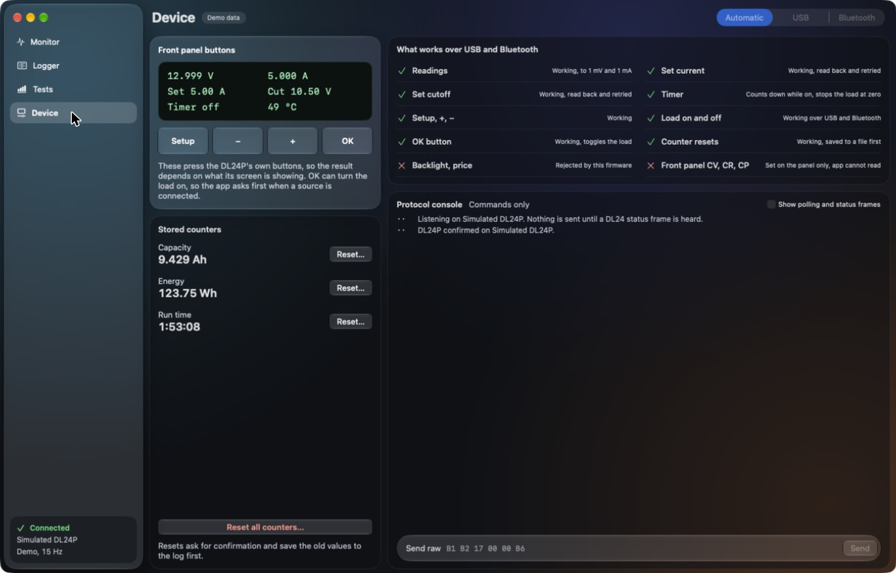

# DL-X Control

A native Liquid Glass macOS app for the ATORCH DL24P electronic load: live monitoring, load control, automated tests and a data logger, over USB or Bluetooth.

> **Only tested with the ATORCH DL24P.** Other ATORCH loads, including other DL24 models and firmware versions, may behave differently or not work. This is an independent project, not affiliated with ATORCH.

## Screenshots



*Monitor, during a real CC-CV run on a DL24P.*

| Logger | Tests |
|---|---|
|  |  |



*Logger, Tests and Device, shown with the app's simulated demo data.*

## Download

Disk images are built by GitHub Actions:

- **Releases:** tagged versions, on the [Releases page](../../releases).
- **Latest build:** from the newest run on the [Actions page](../../actions) (requires a GitHub login).

| File | Runs on |
|---|---|
| `DL-X-Control-…-apple-silicon.dmg` | Apple Silicon Macs |
| `DL-X-Control-…-universal.dmg` | Apple Silicon and Intel Macs |

Requires macOS 26 or later. The Intel slice is compiled by CI but has not been run on an Intel Mac.

The builds aren't notarized, so macOS will block the first launch. Drag the app to Applications, then either use **System Settings > Privacy & Security > Open Anyway**, or run:

```bash
xattr -dr com.apple.quarantine "/Applications/DL-X Control.app"
```

## Features

- **Monitor:** live voltage, current, power and resistance with aligned charts and a cursor
- **Control:** load on and off, current, cutoff and timer, plus CC, and app-regulated CP, CR and CC-CV discharge
- **Logger:** automatic recording, discharge curves, session comparison, marks, and CSV, JSON and PDF export
- **Tests:** editable capacity, internal resistance, supply sweep, soak and custom programs with stop conditions
- **Device:** remote front-panel buttons, counter resets with backup, and a raw protocol console
- **Safety:** confirmation before load-on, read-back of every setting, and automatic stops for overshoot, cutoff, temperature and power

## Using it safely

This software controls equipment that can overheat, damage batteries and start fires. Use it at your own risk, and never leave a test unattended until you have proven it on your own setup. See the [license](LICENSE).

- **Front panel mode.** The app cannot read or set the panel's CC, CV, CR or CP mode. Set the panel to CC before turning the load on. In other modes the load ignores the app's current setting. The app stops the load if current overshoots, but some current flows before it can react. The app's CP, CR and CC-CV work by adjusting the current in CC.
- **CC-CV discharge.** Sinks the CC current until the voltage falls to the CV target, lowers the current to hold that voltage, and turns the load off at the end current. The app runs this at most twice a second, so it is slow, and it can dip a little below the target. The DL24P's cutoff must sit below the target, or it stops the load before CV begins: the app warns about this and does not change the cutoff for you. If the connection drops, the DL24P holds the last current until its own cutoff or timer stops it, so set the cutoff to the lowest voltage the battery can safely reach.
- **USB and Bluetooth share one serial line.** While the USB cable is plugged in, Bluetooth can read but cannot send commands, so the app uses USB. Unplug the cable to control over Bluetooth.
- **USB may not be isolated.** One reverse-engineering source reports no isolation, so with mains-referenced or high-voltage sources, unplug the cable and use Bluetooth.
- **The DL24P timer is a countdown.** It runs only while the load is on, does not reset, stops the load at zero and then turns itself off. The app warns when one is armed and turns it off before test programs.
- **If the connection drops,** the app cannot stop the load until it reconnects. The DL24P's own cutoff and timer keep working, and the app sends its cutoff before each run.

## Test status

Tested on one DL24P, using a 9 V supply at up to 0.3 A:

- USB and Bluetooth: readings, settings, load on and off, automatic switch from USB to Bluetooth
- CC, CP, CR and CC-CV, cutoff stop, overshoot stop, timer stop, load-off on quit, and turning the load off after a lost connection
- Front-panel buttons, all counter resets, a test program

**Not yet tested on hardware:** a CC-CV discharge of a real battery, long runs, currents above 0.3 A, the temperature and power stops, and the Intel build.

## DL24P behaviour worth knowing

Found while testing, and handled by the app:

- A setting is occasionally dropped with no error, so every write is read back and retried.
- One reading is occasionally wrong (0.487 A on a steady 0.299 A, with voltage unchanged), and repeats if asked again at once. Jumps are re-read after a short wait.
- A set-current write produces a phantom reading of about 250 mA, even at 0 V with the load off.
- The energy counter moves in 100 mWh steps, so short tests use energy added up from samples.
- Backlight and price commands are rejected as unsupported.

The commands found on this tester, and what was tried without effect, are in [docs/DL24P-commands.md](docs/DL24P-commands.md).

## Build from source

Needs macOS 26 or later and the Command Line Tools. Xcode is not required.

```bash
./build_app.sh
```

```bash
./build_app.sh universal
```

```bash
open "build/DL-X Control.app"
```

To try it with no hardware, using a simulated DL24P and separate temporary data:

```bash
open "build/DL-X Control.app" --args --demo
```

Protocol and safety checks, using bytes captured from a real unit:

```bash
swift run DLXCoreChecks
```

## Data

Sessions are in `~/Library/Application Support/DL-X Control/Sessions`, one folder each with `meta.json` and an append-only `samples.csv`. Counter values are saved to `counter-resets.jsonl` before any reset.

## Support

This is a hobby project, shared as is, and support is minimal:

- **One tester.** It has only been tested on one ATORCH DL24P with a CH340 USB port and Bluetooth. Newer DL24P boards that connect over USB HID use a different protocol and are not supported.
- **Issues are welcome, but nothing is promised.** There may be no reply, fix or timeline.
- **No other models are planned.** Requests to support other ATORCH loads are unlikely to be taken up.
- **You are responsible for your setup.** The software comes with no warranty, as set out in the [license](LICENSE). Follow the safety notes above, and don't leave a test unattended.

## Layout

- `Sources/DLXCore`: protocol, parser, guards, regulator, test programs, simulator
- `Sources/DLXControl`: transports, device controller, storage, SwiftUI screens
- `Sources/DLXCoreChecks`: checks using bytes captured from a real unit

## Credits

The protocol work builds on public reverse engineering, including [syssi/esphome-atorch-dl24](https://github.com/syssi/esphome-atorch-dl24), [tshaddack/dl24](https://github.com/tshaddack/dl24) and [misdoro/Electronic_load_px100](https://github.com/misdoro/Electronic_load_px100).

## License

[MIT](LICENSE)
